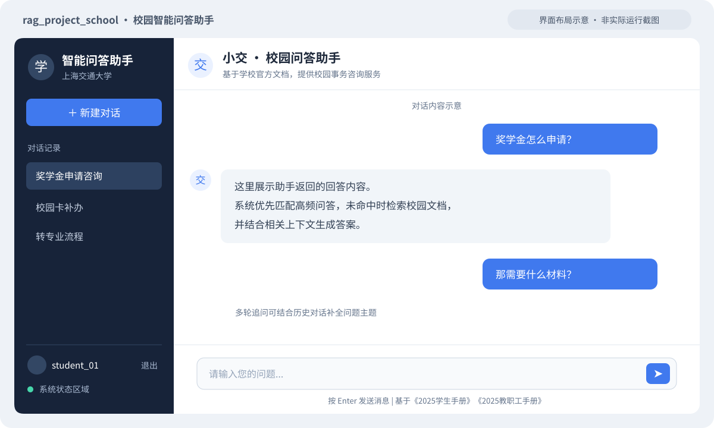
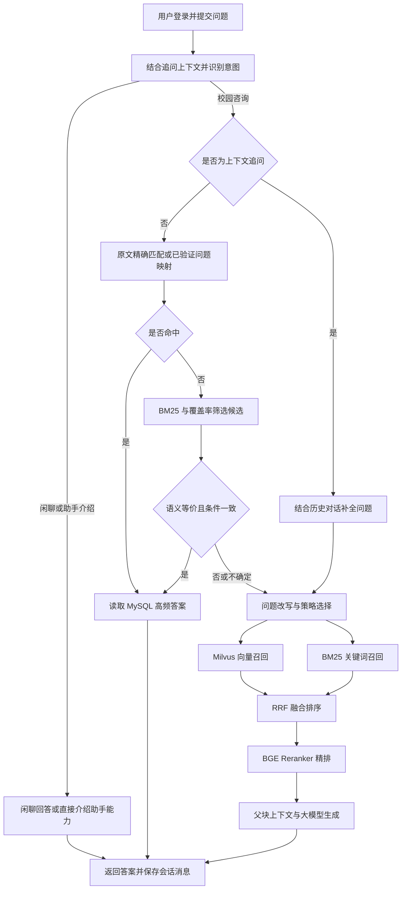

# 校园 RAG 智能问答系统

`rag_project_school` · 基于校园文档与高频问答的智能咨询助手

## 项目介绍

本项目面向校园事务咨询，以《2025学生手册》《2025教职工手册》等 PDF 和高频问答数据为知识来源，为学生、教职工提供自然语言问答服务。

代码仓库不包含实际 PDF、业务问答 CSV、训练 JSON、模型权重或数据库备份，运行时需要单独准备；数据目录说明见 [data/README.md](data/README.md)。

系统先识别问题意图，校园咨询优先匹配高频问答，未命中再进入 RAG：原文相同的问题直接查询 MySQL；其他问法通过 BM25 召回候选，再由现有大模型校验问题是否语义等价，确认后才返回高频答案。Redis 缓存已验证的原始问题映射。需要查阅文档的问题则通过检索增强生成（Retrieval-Augmented Generation，RAG），检索相关内容并交给大模型组织回答。多轮追问会结合历史对话补全问题上下文。询问助手身份或能力时直接介绍助手，闲聊不参与校园高频问答匹配。

项目提供网页聊天界面和 FastAPI 接口，支持账号登录、历史会话管理与文档知识库构建。完整接口说明见 [API.md](API.md)。

## 主要特性

- **高频问答语义校验**：BM25 与关键词覆盖率仅用于候选召回；非原文匹配必须通过对象、事项、条件及否定表达的等价判断。校验不确定或不可用时转 RAG，不直接返回高频答案；已验证问题映射支持 Redis 缓存，答案从 MySQL 读取。
- **文档解析与清洗**：通过 pdfplumber 提取 PDF 文本，过滤重复页眉页脚、目录和页码；文本不足的页面可启用 PaddleOCR 识别。
- **父子分块**：使用较小的子块检索相关内容，并将对应父块作为生成上下文，兼顾匹配粒度与信息完整性。
- **混合检索与精排**：结合 BGE-M3 向量检索和 BM25 关键词检索，通过 RRF 融合排序，再使用 BGE Reranker 筛选候选内容。
- **意图识别与问题改写**：区分校园咨询与闲聊，按问题特征选择改写策略；意图识别支持 BERT、scikit-learn 和规则后端。
- **多轮对话**：结合历史消息处理省略主题的追问，支持新建、切换和删除会话。
- **先浏览，再登录提问**：访问首页即可查看问答界面和示例问题，发送问题时再弹出登录 / 注册窗口；关闭弹窗保留输入，登录成功后继续发送刚才的问题。
- **账号与历史记录**：支持用户注册、登录和退出，使用服务端登录会话与 HttpOnly Cookie；用户只能访问自己的会话，密码通过 PBKDF2-SHA256 加盐保存。
- **忘记密码**：在登录窗口按用户名重置密码，无需原密码；新密码需两次输入一致，重置后旧登录会话失效，历史对话保留。当前演示流程仅检查账户存在性，正式对外部署前需增加身份验证。
- **模型预热与状态查询**：启动后在后台加载模型，通过健康检查接口查看组件和模型是否就绪。
- **可配置的大模型接口**：使用 OpenAI 兼容的 Chat Completions 接口，模型名称、地址和生成参数在配置文件中设置。
- **容器化部署**：提供 Dockerfile 和 Docker Compose 配置，编排应用、MySQL 与 Redis，模型通过本地目录挂载。

## 项目结构

```text
rag_project_school/
├── main.py                         # FastAPI 服务入口、认证与问答接口
├── config.py                       # 配置读取及环境变量覆盖
├── config.ini                      # 数据库、模型和检索参数
├── pyproject.toml                  # Python 项目元数据与依赖
├── uv.lock                         # 本地依赖锁文件（当前被 Git 忽略）
├── Dockerfile                      # 应用镜像构建
├── docker-compose.yml              # 应用、MySQL、Redis 编排
├── .dockerignore                   # 镜像构建上下文排除规则
├── .env.example                    # 密钥配置示例
├── API.md                          # API 接口说明
├── data/
│   ├── 2025学生手册.pdf
│   ├── 2025教职工手册.pdf
│   ├── 高频问答对.csv              # 高频问答导入数据
│   └── 微调数据.json               # 意图模型训练数据
├── model/                          # 本地模型目录，不纳入 Git 和镜像
├── scripts/
│   ├── import_csv_to_mysql.py       # 导入高频问答
│   ├── init_redis.py                # 重建问题索引与缓存
│   ├── migrate_to_docker.py         # 备份、迁移和核对已有数据库内容
│   ├── build_knowledge_base.py      # 重建 PDF 向量知识库
│   ├── train_intent_classifier.py   # 训练 BERT 意图模型
│   ├── train_intent_sklearn.py      # 训练轻量意图模型
│   └── calibrate_qa_thresholds.py   # 高频问答匹配阈值标定
├── src/
│   ├── unified_query_system.py     # 高频问答与 RAG 统一入口
│   ├── auth/                       # 用户认证与登录会话
│   ├── common/                     # 文本处理、特征、环境变量与嵌入单例
│   ├── knowledge_base/             # PDF 解析、父子分块和 Milvus 向量库
│   ├── mysql_qa/                   # 高频问答、Redis 缓存与历史会话存储
│   └── rag_qa/                     # 意图识别、问题改写、混合检索与答案生成
├── templates/
│   └── index.html                  # 登录与聊天页面
├── static/
│   ├── css/style.css               # 页面样式
│   └── js/script.js                # 认证、会话与问答交互
├── docs/images/
│   └── chat-preview.svg            # README 界面布局示意图
└── tests/
    └── test_system.py              # 系统回归测试
```

## 技术栈

| 层级 | 技术 / 模型 | 用途 |
| --- | --- | --- |
| 开发环境 | Python 3.12、uv | 运行环境、依赖管理与锁定 |
| Web 服务 | FastAPI、Uvicorn、Pydantic | HTTP 接口、服务启动与请求校验 |
| 网页界面 | HTML、CSS、原生 JavaScript | 登录、会话管理与聊天交互 |
| 关系数据库 | MySQL 8.0、PyMySQL | 高频问答、用户、登录会话及对话记录 |
| 缓存 | Redis 8.6、redis-py | 问题索引和答案缓存 |
| 向量数据库 | Milvus、PyMilvus | 文档分块存储与向量检索 |
| PDF 与 OCR | pdfplumber、PaddleOCR、PaddlePaddle | 文本提取及扫描页识别 |
| 分词与关键词检索 | jieba、rank-bm25 | 中文分词、BM25 召回 |
| 嵌入模型 | BAAI/bge-m3、Sentence Transformers | 文档与问题向量化 |
| 精排模型 | BAAI/bge-reranker-base、Transformers | 查询与候选文档相关性排序 |
| 意图识别 | BERT、scikit-learn、规则 | 校园咨询与闲聊分类及降级处理 |
| 模型推理 | PyTorch | 本地嵌入、意图和精排模型推理 |
| 答案生成 | OpenAI 兼容接口，当前配置为 DeepSeek | 根据检索上下文生成回答 |
| 部署 | Docker、Docker Compose | 应用镜像与依赖服务编排 |

默认使用 CPU 推理。具体依赖约束见 [pyproject.toml](pyproject.toml)，模型路径和检索参数见 [config.ini](config.ini)。

## 示例图展示

### 网页界面布局

下图依据当前页面模板绘制，用于展示侧栏、会话列表和聊天区域的布局，**不是实际运行截图**；图中的对话文字为占位示例。



实际页面包含登录 / 注册入口、账号信息、系统状态、历史会话列表和问题输入框。登录后可围绕奖学金、学籍管理、校园卡等校园事务发起咨询。

### 问答处理流程



## Docker 部署

当前 Compose 包含 `app`、`mysql`、`redis`、`milvus`、`etcd` 和 `minio` 六个服务。应用通过 Compose 服务名连接容器数据库，**无需另行启动本机 MySQL、Redis 或 Milvus**。以下命令均在项目根目录执行。

### 1. 准备运行环境与文件

- 安装 Docker 和 Docker Compose；Windows 可使用 Docker Desktop 的 Linux 容器模式。
- Compose 使用 Milvus 2.4.4、MySQL 8.0.39 和 Redis 8.6.2，Milvus 的 etcd 与 MinIO 依赖会一起启动。
- MinIO 使用社区维护分支的固定镜像 `pgsty/minio:RELEASE.2026-03-25T00-00-00Z`，替代拉取被拒绝的旧 `minio/minio` 来源。该镜像已验证健康检查以及与 Milvus 2.4.4 的向量写入、落盘、索引、检索和重启后读取兼容；维护方说明见 [pgsty/minio](https://hub.docker.com/r/pgsty/minio)。云端首次部署可直接使用此配置；已有 MinIO 数据的部署应先备份再升级，保留原数据卷。
- 将 PDF 与高频问答 CSV 放入 `data/`，CSV 需要包含 `问题`、`答案` 两列。
- 将本地模型放入下列目录；`bge-m3` 和 `bge-reranker-base` 为默认检索链路所需模型。

```text
model/
├── bge-m3/                 # 嵌入模型
├── bge-reranker-base/      # 精排模型
├── bert_intent/            # 可选：已训练的 BERT 或 sklearn 意图模型
└── bert-base-chinese/      # 可选：训练 BERT 意图模型时使用
```

意图模型后端默认设为 `auto`，优先加载 BERT，再尝试 sklearn，模型不可用时使用规则。

Dockerfile 会复制 `pyproject.toml` 和 `uv.lock`，并通过 `uv sync --locked --no-dev` 安装依赖。锁文件已取消 Git 忽略，构建时使用锁定版本；只有在需要生成或更新锁文件时，才在安装了 uv 的环境中执行：

```bash
uv lock
```

### 2. 配置环境变量

复制配置示例：

```powershell
# Windows PowerShell
Copy-Item .env.example .env
```

```bash
# Linux / macOS
cp .env.example .env
```

编辑 `.env`，填写真实值：

```dotenv
MYSQL_PASSWORD=your_mysql_password
REDIS_PASSWORD=your_redis_password
LLM_API_KEY=your_llm_api_key
```

Compose 从 `.env` 读取这些值，分别注入应用和数据库容器；`.env` 不会复制进镜像。大模型地址、模型名称、分块和检索参数在 `config.ini` 中设置，修改后需要重新构建应用镜像。

当前数据库配置：

| 服务 | 配置 |
| --- | --- |
| MySQL | 数据库 `rag_project_school_db`，高频问答表 `high_frequency_qa` |
| Redis | 逻辑数据库 `1` |
| Milvus | 数据库 `rag_project_school`，集合 `rag_knowledge_base` |

### 3. 构建镜像并启动数据库

云端首次部署、补齐 Milvus 和日常升级，建议使用[统一部署流程](docs/CLOUD_DEPLOY.md)。它使用新镜像内的恢复工具，兼容应用自动创建的空表，并在启动前检查向量数据与模型挂载。旧备份目录里的恢复脚本不会随镜像自动更新。

```bash
docker compose config --quiet
docker compose build app
docker compose up -d --wait --wait-timeout 180 mysql redis milvus
```

模型目录通过只读挂载提供，不包含在应用镜像中；数据目录挂载到 `/app/data`。MySQL、Redis、Milvus、etcd 和 MinIO 分别通过命名卷保存数据。

| 服务 | 宿主机端口 | 容器端口 / 应用连接地址 |
| --- | --- | --- |
| 应用 | `5000` | `5000` |
| MySQL | `3307` | `mysql:3306` |
| Redis | `6380` | `redis:6379` |
| Milvus | `19531` | `milvus:19530` |

应用容器使用 Compose 服务名访问数据库；宿主机管理端口仅绑定 `127.0.0.1`，与原本的 `3306`、`6379`、`19530` 端口区分。etcd 与 MinIO 不向宿主机开放端口。

### 4. 初始化数据库与知识库

**已有项目数据：先迁移，保留账号和历史记录。**

原本机数据库与容器命名卷互相独立。迁移前停止旧应用写入，保留原 MySQL、Redis、Milvus 服务运行，再使用原 Python 环境执行以下命令。备份目录名称需要唯一。恢复允许复用兼容空表，也支持在整个目标库为空时迁移可识别的历史认证表结构；默认不覆盖已有业务记录：

```powershell
.\.venv\Scripts\python.exe scripts/migrate_to_docker.py backup --backup-dir backups/my-migration
.\.venv\Scripts\python.exe scripts/migrate_to_docker.py restore --backup-dir backups/my-migration
```

迁移脚本会保留 MySQL 表结构、账号密码哈希和历史记录，复制 Milvus 文本、向量和索引参数，并迁移 Redis 项目缓存及有效期。恢复后核对 MySQL 和向量内容、Redis 实际键值；不修改源数据库、不覆盖目标中的不同数据。中途中断后，可加 `--resume` 补齐已验证一致的部分。云端部署使用 `--keep-existing` 保留已有业务数据的整个组件，并补恢复其他缺失组件；`--components milvus` 可单独恢复向量库。

快照与校验文件保存在 `backups/`，该目录已从 Git 和镜像构建中排除。备份包含账号和历史消息，请妥善保管。迁移完成后**跳过下方 CSV 导入与知识库重建步骤**，直接启动应用。

**没有旧数据：进行首次初始化。**

在容器中的 Milvus 创建数据库，已存在时跳过：

```bash
docker compose run --rm --no-deps app python -c "from pymilvus import connections, db; from config import MILVUS_CONFIG as c; connections.connect(host=c['host'], port=c['port']); name=c['database_name']; db.create_database(name) if name not in db.list_database() else None; print('Milvus database ready:', name)"
```

依次导入高频问答、初始化 Redis，再构建文档知识库：

```bash
docker compose run --rm --no-deps app python scripts/import_csv_to_mysql.py
docker compose run --rm --no-deps app python scripts/init_redis.py
docker compose run --rm --no-deps app python scripts/build_knowledge_base.py
```

**数据初始化会覆盖已有内容**：CSV 导入脚本会清空并重新写入高频问答表；Redis 初始化会重建问题索引并清空答案缓存；知识库构建脚本会删除并重建配置中的 Milvus 集合。仅在首次部署或需要整体更新数据时执行。

MySQL 容器默认使用 `+08:00` 时区。迁移快照记录源数据库时区，恢复时使用相同的会话时区，保留历史时间及其对应的实际时刻。

### 5. 启动应用与访问

```bash
docker compose up -d --wait --wait-timeout 240
docker compose ps
docker compose logs -f app
```

- 网页界面：[http://localhost:5000](http://localhost:5000)
- 交互式 API 文档：[http://localhost:5000/docs](http://localhost:5000/docs)
- 健康检查：[http://localhost:5000/api/health](http://localhost:5000/api/health)

首次启动会在后台加载模型，耗时取决于设备和模型文件。健康检查的 `models_ready` 为 `true` 表示模型已就绪；仅有 `status: ok` 不代表预热完成。打开网页即可查看问答界面；首次发送问题时会提示登录或注册，认证成功后继续发送该问题。用户与会话数据表由应用启动流程自动创建。

### 6. 日常维护与回归检查

```bash
# 日常一键启动全部服务
docker compose up -d

# 修改代码或 config.ini 后重新构建并启动
docker compose up -d --build app

# 备份当前容器数据，快照写入宿主机的 backups/ 目录
docker compose exec app python scripts/migrate_to_docker.py backup

# 在应用容器中运行回归测试
docker compose exec app python tests/test_system.py

# 停止并移除容器，保留命名卷中的数据库数据
docker compose down
```

回归测试会连接 MySQL、Redis、Milvus 并加载本地模型，应在数据初始化完成后执行。

普通的 `docker compose down`、重启容器或更新应用镜像不会删除命名卷中的数据。不要使用 `docker compose down -v` 或删除项目的数据卷，除非明确要清空数据；命名卷仍然需要定期备份。

迁移完成后按本文使用 Docker 启动应用。直接运行本机 `python main.py` 仍按 `config.ini` 的本机端口连接原数据库，可在需要回退时使用。
